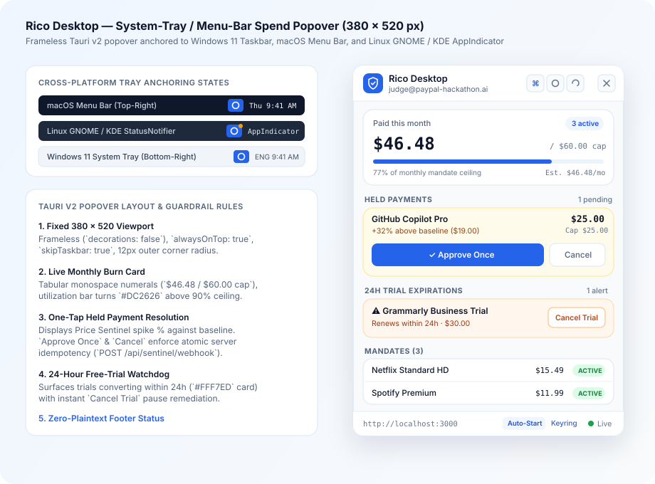
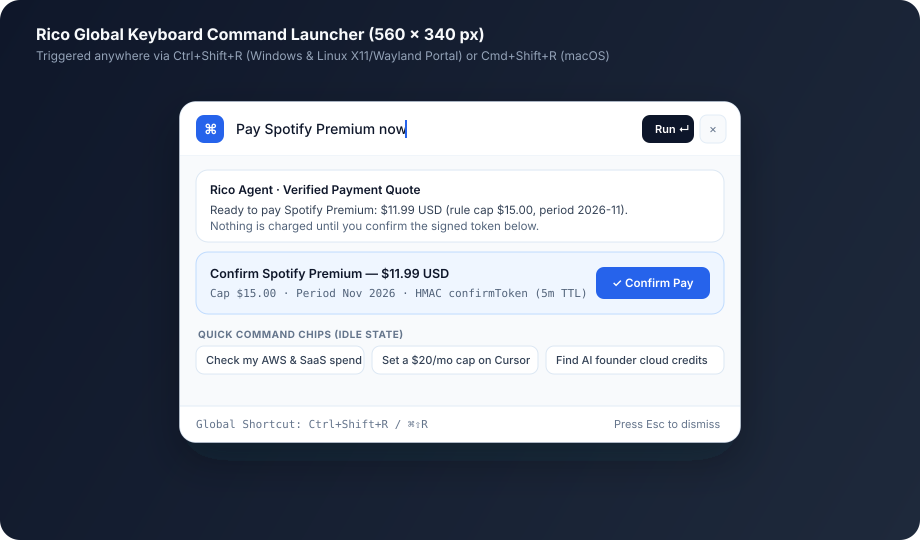
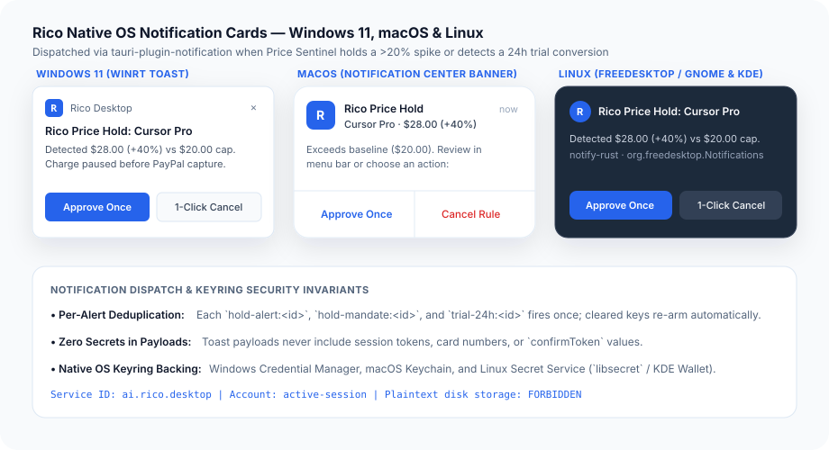
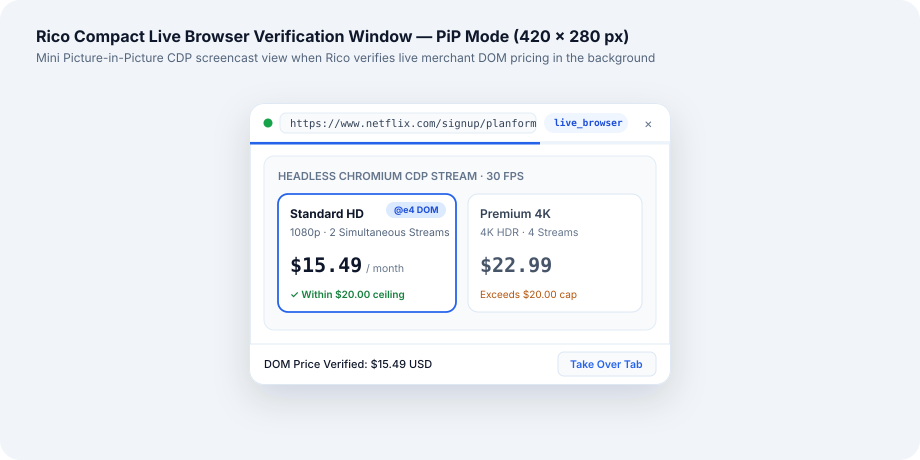

# Desktop Companion UI Specs — Windows, macOS & Linux (`design/desktop/`)

- **Target PR Base Branch:** `track/ui-design`
- **Issue:** [#22 — Design Windows, macOS & Linux Companion App](https://github.com/abrarnasirjaffari/Rico/issues/22)
- **Full Engineering & Layout Spec:** [`SPEC.md`](./SPEC.md)

---

## 🖼️ Mockups & Cross-Platform Views

### 1. System-Tray / Menu-Bar / Linux Top-Bar Spend Popover (`380 × 520`)
Live monthly burn rate, held transactions awaiting `Approve Once` / `Cancel`, upcoming 24-hour free-trial expiration alerts, and cross-platform tray anchoring states across **Windows 11**, **macOS**, and **Linux (GNOME / KDE)**.

---

### 2. Global Keyboard Command Launcher (`560 × 340`)
Instant Spotlight-style floating command bar (`Ctrl+Shift+R` on Windows/Linux, `Cmd+Shift+R` on macOS) with quick FinOps command chips and two-step `confirmToken` payment confirmation.

---

### 3. Native OS Notifications & Keyring Security
Platform-native notification cards across **Windows 11 (WinRT Toast)**, **macOS (Notification Center)**, and **Linux (Freedesktop / GNOME & KDE)** paired with zero-plaintext OS keyring storage (`Windows Credential Manager`, `macOS Keychain`, `Linux libsecret`).

---

### 4. Compact Live Browser Verification Window (`420 × 280` PiP)
Mini Picture-in-Picture Chromium CDP view showing live DOM price extraction (`live_browser` vs `cache_fallback`), `@eN` semantic element grounding, and 1-click **Take Over Tab** handoff.

---

## 📂 Files in `design/desktop/`

| File | Description |
| :--- | :--- |
| [`README.md`](./README.md) | Visual overview and embedded SVG mockups |
| [`SPEC.md`](./SPEC.md) | Complete Tauri v2 window dimensions, design tokens, tray positioning math, and guardrail UX rules |
| [`mockups/01-system-tray-popover.svg`](./mockups/01-system-tray-popover.svg) | `380×520` Spend Popover + Windows/macOS/Linux tray states |
| [`mockups/02-global-command-launcher.svg`](./mockups/02-global-command-launcher.svg) | `560×340` Global Shortcut Spotlight Launcher (`Ctrl+Shift+R` / `Cmd+Shift+R`) |
| [`mockups/03-native-os-notifications.svg`](./mockups/03-native-os-notifications.svg) | Windows 11, macOS, and Freedesktop Linux toast cards + Keyring invariants |
| [`mockups/04-live-browser-pip.svg`](./mockups/04-live-browser-pip.svg) | `420×280` Compact Live Browser PiP verification window |
